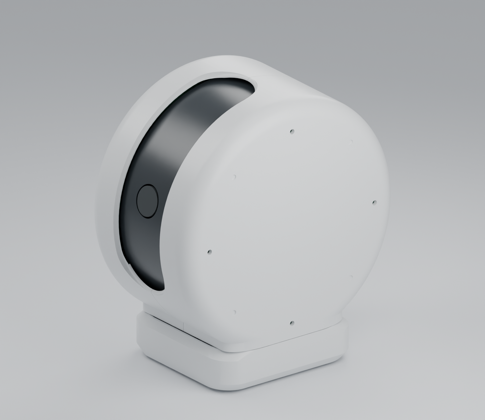

# Dolphin

Dolphin is a desktop pan-and-tilt camera concept with two microphone positions.
The render shows the closed enclosure for the camera and its moving support.
It is a mechanical design preview, not a photo of a built device. The gallery
does not establish validated audio capture, sound-source localization, or
camera control.
